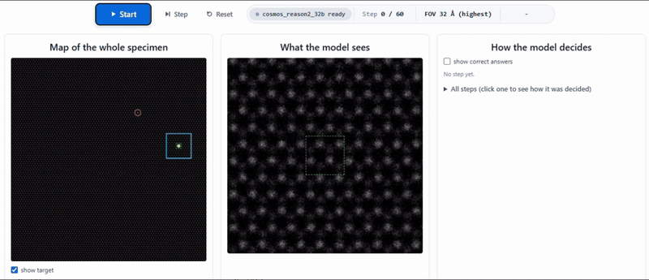

# Sequential Decision-Making for STEM

Vision-language models operate a simulated scanning transmission electron microscope. Starting from a
random field of view on a simulated HAADF-STEM image of monolayer MoS₂, the model must find a target and
centre it at the highest magnification, by moving the field of view, zooming in and out, and declaring
`found`.

<a href="assets/vlm-stem-navigation-demo.mp4">
  
</a>

*A W dopant, then a grain boundary, found and centred in the viewer. Recorded episodes shown in real time (1×), no
fast-forward; click for the MP4.*

| Task | Target |
|---|---|
| `dopant_zoom` | a single W atom substituting Mo: a bright point |
| `grain_boundary` | a Σ7 tilt grain boundary: a line where the lattice orientation changes, with no intensity contrast |

Every decision is one question about the current image: where is the target relative to the green square at
the centre (left / right / up / down / inside / none)? The **agent** asks it through a **reader** and turns the
answer into an action with fixed rules. The readers are what is compared: `typed` (a **decision server** reads the
probability of every label in one pass, in the format of TypeSafe's System One API), `generated` (the model writes
its label) and `generated_thinking` (it thinks first). The prompts and rules are the same for every reader, model
and task; the task-specific text is a one-sentence target description.

See [License](#-license) for what is third-party (openjev, vLLM, abTEM, model checkpoints) and under which terms.

## 🚀 Quick start

```bash
uv sync && scripts/viewer.sh cosmos_reason2_32b   # serve a model and watch it in the browser: http://<this machine>:8090
```

The 32B is 67 GB in BF16 and needs a 96 GB GPU (an RTX PRO 6000). On a 48 GB Blackwell GPU (an RTX PRO 5000),
use Gemma 4 26B-A4B in NVFP4: `scripts/viewer.sh gemma4` (NVFP4 needs a Blackwell GPU). On other GPUs, use the
Cosmos-Reason2 8B (17 GB): `scripts/viewer.sh cosmos_reason2_8b`; its repository is gated (accept the licence on
its Hugging Face page and log in with `hf auth login`).

`scripts/viewer.sh <model>` starts the model's vLLM server (port 8000), the decision server (8080) and
the viewer (8090); Ctrl+C stops all three. `scripts/viewer.sh -h` lists the models. The first start of a
model downloads it and compiles kernels (several minutes). The viewer has no authentication; on an
untrusted network use an SSH tunnel (`ssh -L 8090:localhost:8090 <host>`).

`src/serving/serve_model.sh <model> [<reader>]` starts only the model's servers (the generated readers need its
reasoning flags: `src/serving/serve_model.sh cosmos_reason2_32b generated_thinking`); `scripts/viewer.sh` (no model) then opens
the viewer on it.

## 📊 Benchmark

The comparison of the readers is [`experiments/answer_types/`](experiments/answer_types/README.md):

```bash
uv run python experiments/answer_types/run.py --config experiments/answer_types/configs/smoke.yaml
```

`smoke.yaml` is a short run to try it; the paper's runs are the `answer_types_v2*.yaml` configs, one run per model (see
each config's header).

The simulated images are in `data/` (~40 MB); [`data/README.md`](data/README.md) explains how to
regenerate them.

## 📄 License

MIT (`LICENSE`), except the three files adapted from [openjev](https://github.com/razorback16/openjev) (commit
`a0ddd7d`), which stay under Apache-2.0 (`src/serving/decision_server/LICENSE`) and are marked
`SPDX-License-Identifier: Apache-2.0`: `src/serving/decision_server/api.py`, `src/serving/decision_server/vllm_engine.py`
and `src/agent/prompts/layout.py`.

Used as dependencies, not included: [vLLM](https://github.com/vllm-project/vllm) (Apache-2.0),
[abTEM](https://github.com/abTEM/abTEM) (GPL-3.0-or-later; imported only by `src/simulator/generation/simulate_*.py`,
which produce `data/`) and [ASE](https://wiki.fysik.dtu.dk/ase/) (LGPL-2.1-or-later). Model checkpoints are downloaded
from Hugging Face at run time and not redistributed; each has its own terms (see its model card).

The request and response shapes of the decision server follow TypeSafe's published System One API, as openjev does;
no TypeSafe code is included.
